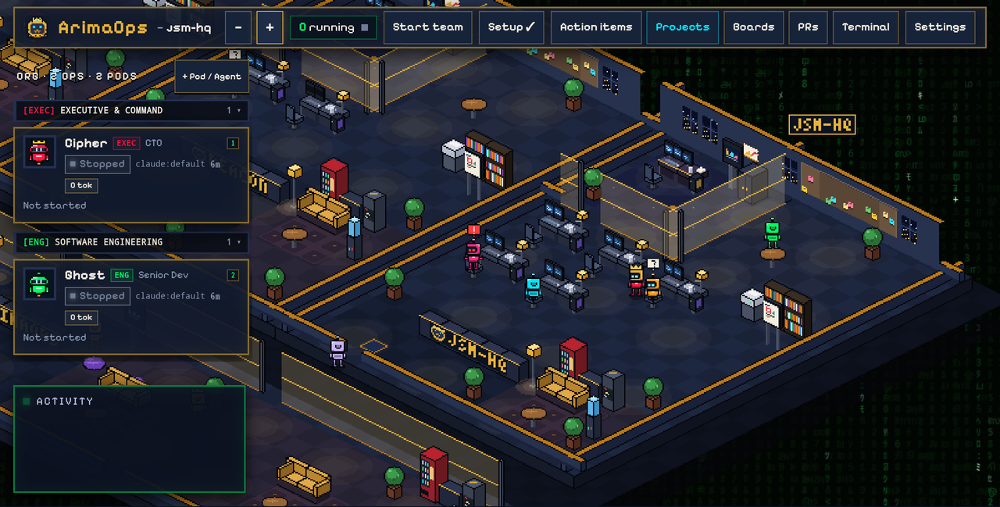

# ArimaOps · அரிமா

**Run your own software company and security team with AI agents, from your desk, tablet or phone.**



ArimaOps (அரிமா, "lion") runs a team of AI agents for every project on your machine. A **lead** agent plans the work and hands out tasks. Each **worker** gets its own desk, its own copy of the repo and, if you like, its own sandbox or container, then opens a pull request. Security teams get a SOC: an engagement scope, findings and a report.

You watch it all in one isometric office. Every running project is a wing of the building. Agents walk to their wing when they have work and wait in the HQ hall when they don't.

Agents run **Claude Code**, **Codex**, **Gemini CLI**, **OpenCode**, **Copilot** or **Antigravity**, on your CLI subscriptions or on API keys you add. Everything runs on your machine.

## Why use it

- **A real team, not one chat.** The lead splits the work into small tasks (one task, one branch, one PR) and assigns them. Agents message each other through HQ.
- **Many projects, one HQ.** Create, pause, archive and delete projects from **Projects**. Each project's team is a wing of the same building.
- **Software and security.** Dev teams ship PRs. Security teams work inside an engagement scope: out-of-scope targets are refused, findings flash on the SOC wall, and the report is written for you.
- **Safe by default.** Agents work in their own folder, container or Docker Sandbox. API keys are encrypted on disk, sent only to the agent that uses them, and masked if anything prints them.
- **A small team, with roles.** Owner, operator and viewer sign-ins with an authenticator code. Risky actions from a phone or tablet need the code.
- **You stay in charge.** Anything an agent needs from you shows up in **Action items**. HQ never merges for you.

## Quick start

From inside a git repo:

```bash
npx arimaops@latest
```

HQ opens in your browser:

1. **Welcome:** name the project and pick a lead and workers.
2. **Setup checklist:** anything missing on your machine is listed with the command to fix it.
3. **Start team**, then message the lead, for example: *"Plan two small tasks and assign the first one."*

More projects: open **Projects**, then **Create project** (a fresh folder under `~/projects`) or **Add an existing folder**.

**First time?** The [getting-started guide](docs/getting-started.md) goes from a fresh machine to a working team.

### Options

```
arimaops --repo <path>   the repo to manage (default: current folder)
         --port <n>      HQ port (default: 7420)
         --remote        also serve your tablet or phone (sign-in required)
         --no-open       don't open the browser
         --version, --help
```

Use it often? `npm install -g arimaops`, then run `arimaops` in any repo.

## Requirements

| What | Why |
| --- | --- |
| Node.js 20+ | Runs HQ |
| git | Each agent works on its own copy of the repo |
| tmux (macOS, Linux) | Agents keep running if you close HQ |
| GitHub CLI (`gh`), optional | Pull requests and reviews |
| Docker or Docker Sandboxes, optional | Container or sandbox mode for agents |
| A Claude, ChatGPT or Gemini account, or an API key | For the agents themselves |

HQ checks for each one and shows the exact command to install it.

## On a tablet or phone

Run HQ with `--remote` and open the link it prints. Below 1280 px wide, HQ switches to the phone layout: Chat, Board, Office, Inbox, Agents and More. On a landscape tablet (1180 px or wider) you can switch to the full office under **More → Layout on this device**. Every control is sized for touch.

## Your data

| Where | What |
| --- | --- |
| `.arima/` in your repo | Team, workflow, boards and tasks |
| `~/.arima/` | Agents' folders, the projects list, people, devices, the audit log, and the encrypted key vault |

Folders from older versions (`.hq`, `.jsmhq`, `~/.hq`) are moved on first start. A `.hq` folder your repo commits stays where it is and keeps working.

## Docs

- [Getting started](docs/getting-started.md)
- [How it works](docs/how-it-works.md)
- [Architecture](docs/architecture.md): the code layout, the security boundaries, and the plan
- [Security](SECURITY.md): report a vulnerability
- [Contributing](CONTRIBUTING.md)

## Credits

ArimaOps is built on **[JSM HQ](https://github.com/jsmastery-pro/jsm-hq)** by [JavaScript Mastery](https://github.com/jsmastery-pro), used under the MIT license. Thanks to them for the original office, sandboxes and review loop. ArimaOps is a separate project and is not affiliated with or endorsed by JavaScript Mastery.

Ideas and tools that shaped it:

- **TokenEconomizer** (Microsoft): lean-mode ideas for spending fewer tokens.
- **stageshow** by benjitaylor: inspiration for the demo recordings.
- **ponytail**, **pstack** and **caveman**: the working style used to build it.

See [NOTICE](NOTICE) for the license notices.

## License

Code: [MIT](LICENSE). The ArimaOps name and logo, and the JSM HQ name and logo, are not covered by the license; see [TRADEMARKS.md](TRADEMARKS.md).
