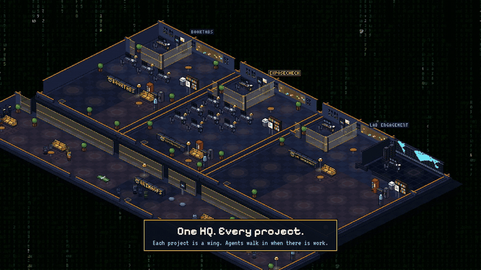

# ArimaOps · அரிமா

### Lead the pride.

**Build an AI team for any job (dev, security, research or marketing) from a template, and run it from your phone.**

[](https://github.com/sachindots/arimaops/releases/download/media-showcase/arimaops-showcase.mp4)

▶ **Watch the 40-second showcase:** [16:9](https://github.com/sachindots/arimaops/releases/download/media-showcase/arimaops-showcase.mp4) · [vertical](https://github.com/sachindots/arimaops/releases/download/media-showcase/arimaops-showcase-vertical.mp4). Real teams, real work: 45 minutes in a time-lapse, and a security engagement on a deliberately vulnerable lab app.

ArimaOps (அரிமா, "lion") runs a team of AI agents for every project on your machine. A **lead** agent plans the work and hands out tasks. Each **worker** gets its own copy of the repo and, if you like, its own sandbox or container, then opens a pull request or delivers a file. Security teams work inside an engagement scope and end with a findings report.

Every team starts from a **template**: its roles, its **flow** (the stages a task goes through and the gates between them), a starter board and its tool rules. Built in: Dev; Security Red, Blue and Purple; Research; Marketing and Sales (drafts only). Change any of it per project, or save your own.

You run it from a HUD:

- **Home:** the team in orbit around a live core, each agent with its state, its task and the tokens it spent today; the flow's stages along the bottom.
- **Command center:** every agent of every project, needs-you first, with a live terminal for the one you pick.
- **Board, Inbox, Flow, PRs, Findings, Usage:** the tasks, what's waiting on you, the flow canvas, pull requests, security findings, and tokens and cost per agent.

Agents run **Claude Code**, **Codex**, **Gemini CLI**, **OpenCode**, **Copilot** or **Antigravity**, on your CLI subscriptions or on API keys you add. Everything runs on your machine.

## Why use it

- **A real team, not one chat.** The lead splits the work into small tasks (one task, one branch, one PR) and assigns them. Agents message each other through HQ.
- **Many projects, one HQ.** Create, pause, archive and delete projects from **Projects**.
- **Gates, not hope.** A task leaves a stage only when its gates pass: tests and green CI, a reviewer, a second opinion from another maker's model, your approval, screenshots of the running app for UI changes.
- **Software and security.** Dev teams ship PRs. Security teams work inside an engagement scope: out-of-scope targets are refused, findings carry CVSS 4.0 scores, and the report is written for you.
- **Know what it costs.** Tokens and estimated cost per agent, per task and per day, with spend caps per project.
- **Safe by default.** Agents work in their own folder, container or Docker Sandbox. API keys are encrypted on disk, sent only to the agent that uses them, and masked if anything prints them.
- **A small team, with roles.** Owner, operator and viewer sign-ins with an authenticator code. Risky actions from a phone or tablet need the code.
- **You stay in charge.** Anything an agent needs from you shows up in the **Inbox**. HQ never merges for you.

## Quick start

From inside a git repo:

```bash
npx arimaops@latest
```

HQ opens in your browser:

1. **Welcome:** name the project and pick a lead and workers.
2. **Setup checklist:** anything missing on your machine is listed with the command to fix it.
3. **Start team**, then message the lead, for example: *"Plan two small tasks and assign the first one."*

More projects: open **Projects**, then **Create project** (a fresh folder under `~/projects`) or **Add an existing folder**.

### Try the demo first

No HQ, no accounts, nothing runs on your machine but the page:

```bash
pnpm install
pnpm dev
```

Open the link Vite prints. The demo has sample projects (a product build and a security engagement) with agents working through their flows; a **Demo** tag sits next to the project name.

**First time?** The [getting-started guide](docs/getting-started.md) goes from a fresh machine to a working team.

### Options

```
arimaops --repo <path>   the repo to manage (default: current folder)
         --port <n>      HQ port (default: 7420)
         --remote        also serve your tablet or phone (sign-in required)
         --no-open       don't open the browser
         --version, --help
```

Use it often? `npm install -g arimaops`, then run `arimaops` in any repo.

## Requirements

| What | Why |
| --- | --- |
| Node.js 22+ | Runs HQ |
| git | Each agent works on its own copy of the repo |
| tmux (macOS, Linux) | Agents keep running if you close HQ |
| GitHub CLI (`gh`), optional | Pull requests and reviews |
| Docker or Docker Sandboxes, optional | Container or sandbox mode for agents |
| A Claude, ChatGPT or Gemini account, or an API key | For the agents themselves |

HQ checks for each one and shows the exact command to install it.

## On a tablet or phone

Run HQ with `--remote` and open the link it prints. Below 1000 px wide, HQ switches to the compact layout: Home, Board, Inbox, Agents, Chat and More, with the same HUD home. The flow canvas is view-only on phones; edit it on a tablet or computer. Every control is sized for touch.

### Build the Android app

The Java app in `android/` runs on Android 12 or later. Add your Firebase Android app's `google-services.json` to `android/app/` (gitignored). Set `JAVA_HOME` to a full JDK 21 installation, add its `bin` directory to `PATH`, and set `ANDROID_HOME` to your Android SDK with platform 36 installed. From the repo root, run:

```bash
npx tsx scripts/android-test.ts
android/gradlew -p android assembleDebug lintDebug
adb install -r android/app/build/outputs/apk/debug/app-debug.apk
```

Open **ArimaOps** and enter your HQ's HTTPS URL. Connect Tailscale first if the server needs it. HTTP works only for localhost development. Saved servers retain separate cookies. In the compact layout, **More → Switch server** returns to the connection screen. Back closes setup, settings, or a drawer before using web history. Links to other origins open in another app.

Rotating the tablet keeps your open page and unsaved form in place. A landscape tablet (1000 px or wider) gets the desktop layout.

Deploy the web UI from this checkout to enable the Back handler and **Switch server** on your HQ. Notification links use `arimaops://open?path=%2F%3Fopen%3Dboard`; paths stay on a saved server. The APK above is a debug build for local installation.

### Enable Android alerts

On the HQ host, run this as the same user that runs HQ:

```bash
npx tsx scripts/configure-push.ts /private/path/firebase-service-account.json
```

The command verifies Firebase authorization and stores the credential in the encrypted vault as `push:fcm`. Keep service-account files outside the repo. Sign in to HQ in the Android app and allow notifications. The app registers its current Firebase token with your signed-in device and refreshes it when you return to the app. Push uses FCM HTTP v1 and does not need an incoming public port on HQ.

Alerts cover agents waiting for input, stalled agents, action and access requests, merged pull requests, high or critical findings, and deployment events. Viewers receive informational alerts. Revoked sessions and disabled users receive none. Notification taps open the corresponding project on the saved HQ that sent the alert.

Run `npx tsx scripts/push-test.ts` to check delivery, token rotation, roles, revocation, deduplication, and registration authentication without contacting Firebase.

### Change your password in the app

Open **More → Settings → Users → Change your password**. Enter your current password and a new password of 10 to 200 characters, then confirm the new password. Your other devices are signed out, and the current device gets a new session. Changing your own password does not require the owner's admin reset or an authenticator code.

## Your data

| Where | What |
| --- | --- |
| `.arima/` in your repo | Team, workflow, boards and tasks |
| `~/.arima/` | Agents' folders, the projects list, people, devices, the audit log, and the encrypted key vault |

Folders from older versions (`.hq`, `~/.hq`) are moved on first start. A `.hq` folder your repo commits stays where it is and keeps working.

## Docs

- [Getting started](docs/getting-started.md)
- [How it works](docs/how-it-works.md)
- [Architecture](docs/architecture.md): the code layout, the security boundaries, and the plan
- [Security](SECURITY.md): report a vulnerability
- [Contributing](CONTRIBUTING.md)

## Credits

Ideas and tools that shaped it:

- **TokenEconomizer** (Microsoft): lean-mode ideas for spending fewer tokens.
- **stageshow** by benjitaylor: inspiration for the demo recordings.
- **ponytail**, **pstack** and **caveman**: the working style used to build it.

See [NOTICE](NOTICE) for the license notices.

## License

Code: MIT for the code ArimaOps started with, AGPL-3.0-or-later for files marked so, and a commercial licence for `ee/`; see [LICENSE](LICENSE). The ArimaOps name and logo are not covered by the license; see [TRADEMARKS.md](TRADEMARKS.md).
