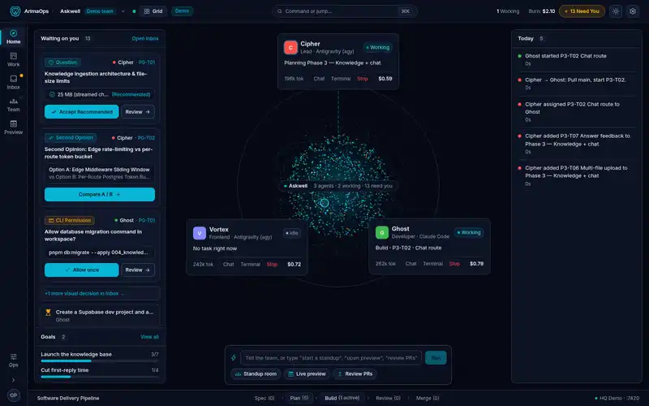

# ArimaOps · அரிமா

### An AI team for every project. You stay in charge.

**Website: [arimaops.tech](https://arimaops.tech/)** · [Features](https://arimaops.tech/features.html) · [Case studies](https://arimaops.tech/case-studies.html)

[](https://arimaops.tech/)

▶ **[Watch the 90-second tour](https://arimaops.tech/assets/video/tour.mp4)** (first run, sign-in, the team at work). More demos: [dev team, 37 s](https://arimaops.tech/assets/video/demo.mp4) · [red team, 27 s](https://arimaops.tech/assets/video/demo-red.mp4) (sample projects from the built-in demo).

**Real runs:** [RoleFit case study](https://arimaops.tech/case-studies.html#rolefit) (6-agent Antigravity Dev team: 6 merged PRs, 202 Vitest tests, 30 Verifier screenshots, [live app](https://sachinselvaraju.tech/rolefit/)).

ArimaOps (அரிமா, "lion") runs a team of AI agents on your own machine. A **lead** plans the work and hands out tasks. Each **worker** builds in its own copy of the repo, in its own folder, container or Docker Sandbox, then opens a pull request or delivers a file. A **reviewer** and a **second model** from another maker check each other, and **gates** decide when a task is really done. You watch, steer and approve from your desk or your phone. HQ never merges or sends for you.

## Fast and light

HQ, the server, is a single Rust binary (axum, tokio, SQLite). Measured against the earlier Node server on one machine, both limited to 2 CPUs and 1 GB: **3 MiB** memory at idle (Node 78 to 95), **37.8k** requests a second (Node 15.2k), **14 ms** slowest-1% latency (Node 37), **27 MiB** with 300 live connections (Node 105). Models still set the pace of the work, and Rust was not faster at opening connections. Method and every number: [docs/benchmarks.md](docs/benchmarks.md).

Free and open source. Agents run **Claude Code**, **Codex**, **Antigravity**, **OpenCode**, **Gemini CLI** or **GitHub Copilot**, on the subscriptions you already have, API keys you add, or free models.

## Who it's for

| You are | What you get | Templates |
| --- | --- | --- |
| **A solo developer** | Brief the lead in a sentence; it writes a spec you approve and splits it into small tasks (one task, one branch, one PR). A reviewer runs every branch, another maker's model gives a second opinion, and tests with green CI are a gate. Approve from your phone. | Dev, Blank |
| **A small team or startup** | A team per job, planned against your goals: a chief of staff with design, marketing, sales, support and ops makers, a Monday plan, a Friday retro and a monthly numbers review. Daily and monthly spend caps, a budget per role, standup notes. Emails and posts stay drafts until you press Send. Owner, operator and viewer sign-ins. | Startup, Marketing, Sales |
| **A security tester** | Authorised testing with a gate on every step: no work until you set the scope, out-of-scope targets refused by HQ, anything that changes the target waits for you. Findings carry evidence, CVSS 4.0, CWE, ATT&CK and WSTG, are checked by a second model, and export to Markdown, JSON, SARIF, HackerOne or Bugcrowd. | Security · Red, Purple, Blue |
| **A researcher or writer** | Sources logged first, claims that cite them (arXiv, OpenAlex and Crossref built in), a fact-checker on a different model, and a third model to sign off the report. Work lands as files, accepted by someone other than the author. | Research |

Every template sets the roles, the **flow** (the stages a task goes through and the gates between them), a starter board and the tool rules. Change any of it per project, or save your own.

## What's in the app

- **Home:** the team around a live core, with what needs you on the left and today's activity on the right.
- **Chat:** a team channel and a thread per agent. Agents write short messages tagged Done, Blocked, Question, FYI or Disagrees; task IDs are links; type @ to address an agent.
- **Board:** tasks by status, filtered by agent, goal or stage. A task opens beside the board with its spec items, gates, checks and history.
- **Inbox:** everything waiting on you (specs, plans, sends, limits, memories, access requests, PRs ready to merge), marked *cannot undo* where it's final. `j` `k` to move, `a` to approve, `r` to send back.
- **Agents and Grid:** who runs on what (with a *free* tag), status, task and today's cost; every project's agents beside a live terminal.
- **Goals:** a metric and target per goal, with linked tasks and spend.
- **Flow:** the stages, who works each one and the 11 kinds of gate. Drag to reorder, click to edit.
- **Pull requests:** review state, checks, conflicts and a file summary for each PR.
- **Usage:** tokens and estimated cost by agent, the share on free models and the budget left today.
- **Findings:** security findings by severity with the scope beside them and the report in six formats.
- **Settings:** project, team, workflow, sandbox, accounts and people, integrations and memory, each in its own section.

The [features page](https://arimaops.tech/features.html) shows each screen.

## Models: paid and free

- **Your CLIs and subscriptions,** signed in with your own accounts, or API keys you add. Keys are encrypted on disk, sent only to the agent that uses them, and masked if anything prints them.
- **Free models:** OpenCode Zen with no key, plus OpenRouter, NVIDIA NIM and AMD Token Lab with a free key. HQ re-reads the free list every day and moves a role to the closest free model when its model stops being free.
- **One-step setup** proposes a model for every role from what your machine has (below).

## Safe by default

- Each agent works in its own folder, container or Docker Sandbox (a small VM, 2 GB by default). HQ starts an agent only while there's RAM to spare and queues the rest.
- Containers reach the internet only through HQ's proxy and an allow-list per agent.
- Owner, operator and viewer sign-ins with an authenticator code; risky actions from a phone or tablet need the code. A log records who approved what.
- HQ never merges a pull request or sends a message for you.

## Quick start

From inside a git repo:

```bash
curl -fsSL https://raw.githubusercontent.com/sachindots/arimaops/main/install.sh | sh
```

HQ opens in your browser:

1. **Welcome:** name the project and pick a lead and workers.
2. **Setup checklist:** anything missing on your machine is listed with the command to fix it.
3. **Start team**, then message the lead, for example: *"Plan two small tasks and assign the first one."*

More projects: open **Projects**, then **Create project** (a fresh folder under `~/projects`) or **Add an existing folder**.

### Try the demo first

No HQ, no accounts, nothing runs on your machine but the page:

```bash
pnpm install
pnpm dev
```

Open the link Vite prints. The demo has sample projects (a product build and a security engagement) with agents working through their flows; a **Demo** tag sits next to the project name.

**First time?** The [getting-started guide](docs/getting-started.md) goes from a fresh machine to a working team.

### Configuration

Configure HQ via environment variables or `compose.yaml` (see `deploy/compose.env.example`).

```bash
docker compose up -d                    # start ArimaOps HQ
docker compose logs -f hq               # follow HQ logs
docker exec arimaops-hq-1 arima-server migrate-v1 --dry-run --json   # preview migrating ~/.arima
```

Upgrade cleanly at any time by re-running `install.sh` or `docker compose pull && docker compose up -d`.

### Set up models in one step

Open **Settings → Team** (or **Detect CLI setup** in onboarding) to propose a model for every role from your connected CLIs and providers.

Paid models go to the lead and the builders, free ones to review, QA and docs, and a free fallback takes over when a paid account hits its limit (it still asks first).

## Requirements

| What | Why |
| --- | --- |
| Docker + Compose v2 | Runs HQ and isolated agent containers |
| git | Each agent works on its own copy of the repo |
| GitHub CLI (`gh`), optional | Pull requests and reviews |
| A Claude, ChatGPT or Gemini account, or an API key | For the agents themselves |

HQ checks for each one and shows the exact command to install it.

## On a tablet or phone

Run HQ with `--remote` and open the link it prints. Below 1000 px wide, HQ switches to the compact layout: Home, Board, Inbox, Agents, Chat and More, with the same data and actions. The flow canvas is view-only on phones; edit it on a tablet or computer. Every control is sized for touch.

### Build the Android app

The Java app in `android/` runs on Android 12 or later. Add your Firebase Android app's `google-services.json` to `android/app/` (gitignored). Set `JAVA_HOME` to a full JDK 21 installation, add its `bin` directory to `PATH`, and set `ANDROID_HOME` to your Android SDK with platform 36 installed. From the repo root, run:

```bash
npx tsx scripts/android-test.ts
android/gradlew -p android assembleDebug lintDebug
adb install -r android/app/build/outputs/apk/debug/app-debug.apk
```

Open **ArimaOps** and enter your HQ's HTTPS URL. Connect Tailscale first if the server needs it. HTTP works only for localhost development. Saved servers retain separate cookies. In the compact layout, **More → Switch server** returns to the connection screen. Back closes setup, settings, or a drawer before using web history. Links to other origins open in another app.

Rotating the tablet keeps your open page and unsaved form in place. A landscape tablet (1000 px or wider) gets the desktop layout.

Deploy the web UI from this checkout to enable the Back handler and **Switch server** on your HQ. Notification links use `arimaops://open?path=%2F%3Fopen%3Dboard`; paths stay on a saved server. The APK above is a debug build for local installation.

### Android device push tokens

Sign in to HQ in the Android app and allow notifications. The app registers its current Firebase token via `POST /api/push/register` and removes it on unregister via `DELETE /api/push/register`. Notification taps open the corresponding project on the saved HQ (`arimaops://open?...`).

### Change your password in the app

Open **More → Settings → Users → Change your password**. Enter your current password and a new password of 10 to 200 characters, then confirm the new password. Your other devices are signed out, and the current device gets a new session. Changing your own password does not require the owner's admin reset or an authenticator code.

## Your data

| Where | What |
| --- | --- |
| `.arima/` in your repo | Team, workflow, boards and tasks |
| `~/.arima/` | Agents' folders, the projects list, people, devices, the audit log, and the encrypted key vault |

Folders from older versions (`.hq`, `~/.hq`) are moved on first start. A `.hq` folder your repo commits stays where it is and keeps working.

## Docs

- [Getting started](docs/getting-started.md)
- [How it works](docs/how-it-works.md)
- [Architecture](docs/architecture.md): the code layout, the security boundaries, and the plan
- [Security](SECURITY.md): report a vulnerability
- [Contributing](CONTRIBUTING.md)

## License

Code: MIT for the code ArimaOps started with, AGPL-3.0-or-later for files marked so, and a commercial licence for `ee/`; see [LICENSE](LICENSE). The ArimaOps name and logo are not covered by the license; see [TRADEMARKS.md](TRADEMARKS.md).
